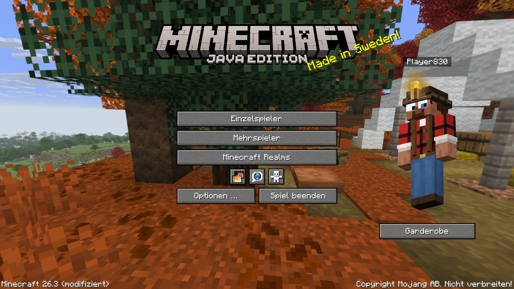
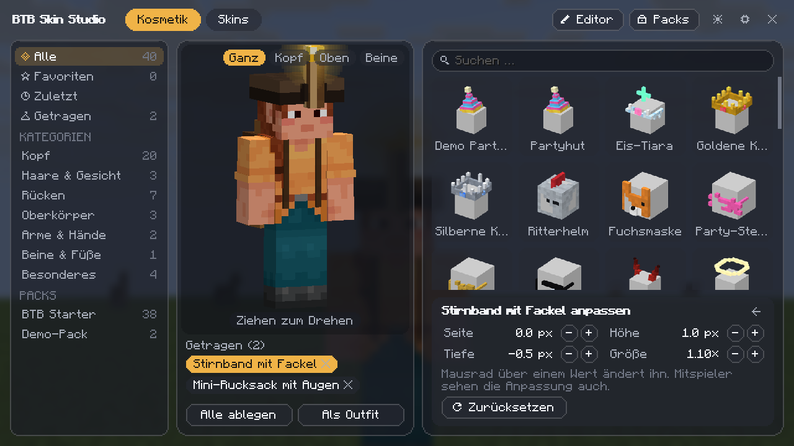
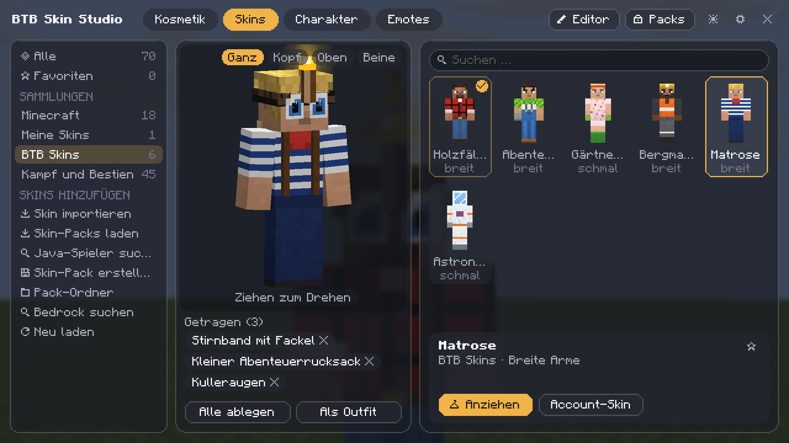
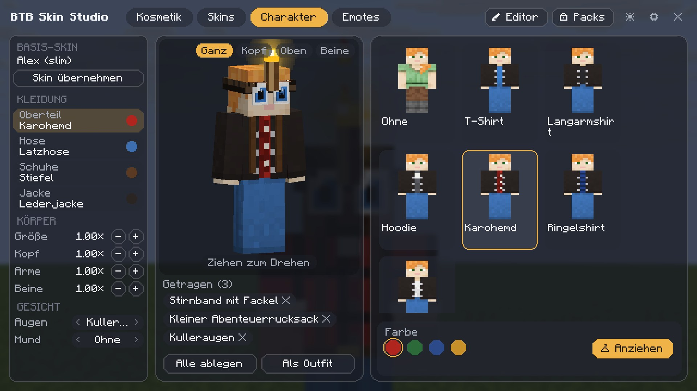
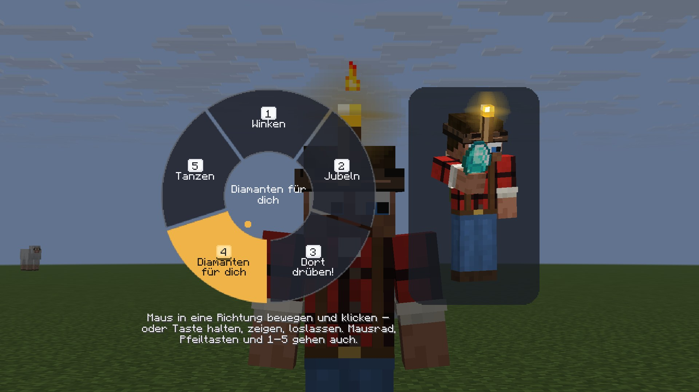
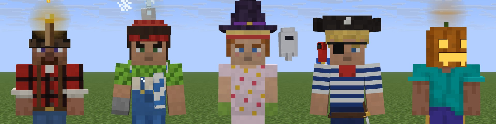
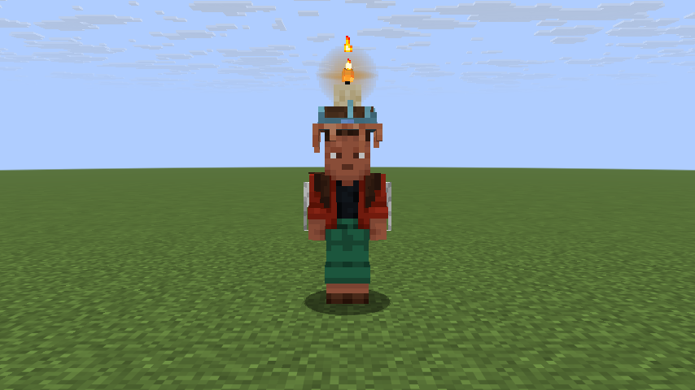

# BTB Skin Studio – Cosmetics für Minecraft Java

**Cosmetics, Garderobe und Cosmetic-Editor für Minecraft 26.3 (Fabric)** – Teil der BTB-Studios-Mod-Familie (*Behind The Blocks*). Hüte, Kronen, Brillen, Rucksäcke, Flügel, Begleiter und Effekte, die man frei kombinieren, einfärben, selbst bauen, als Pack teilen und aus Bedrock-Ressourcen übernehmen kann. Im Multiplayer sehen alle Spieler mit der Mod die Cosmetics der anderen.

*English: A Fabric mod for Minecraft 26.3 that adds wearable cosmetics, a wardrobe with live 3D preview, a Bedrock-style character creator (clothes, body proportions, eyes and mouths), 20 emotes with an emote wheel, skins and Bedrock skin packs (from the Bedrock installation, resource packs or an online catalog), Java player skin lookup, a skin pack builder, 3D skin layers, a cosmetic editor, an own pack format (.btbcosmeticpack / .btbcosmetic / .btbskin), an importer for unencrypted Bedrock resources (Persona pieces, skin-pack accessories, Blockbench models) and multiplayer sync. The in-game UI is fully available in German and English (follows the game language); the docs are in German.*


| | |
|---|---|
| Minecraft | 26.3 (Java Edition) |
| Fabric Loader | ≥ 0.20.1 |
| Fabric API | ≥ 0.166.2+26.3 |
| Java | 25 |
| Mod-ID | `btb_skinstudio` |
| Lizenz | LGPL-3.0-only |

## Was die Mod kann

**Menüfigur wie in Bedrock**
- Im Haupt- und Pausenmenü steht die eigene Figur in 3D mit allen Cosmetics, schaut dem Mauszeiger nach und lässt sich mit der Maus drehen; darunter der Button „Garderobe“ (abschaltbar)



**Garderobe (Taste J, oder Button „Garderobe“ im Pausen- und Hauptmenü)**
- Kategorien Kopf, Haare & Gesicht, Rücken, Oberkörper, Arme & Hände, Beine & Füße, Besonderes – mit 44 Untertypen
- Suche (Name, Typ, Schlagworte), Favoriten (Stern oder Rechtsklick), zuletzt verwendet, Ausgerüstet, Filter nach Pack
- Große 3D-Vorschau zum Drehen mit Ansichten Ganz/Kopf/Oben/Beine; ein ausgewähltes Cosmetic wird sofort anprobiert
- Mehrere Cosmetics gleichzeitig tragen. Konflikte werden automatisch gelöst: Ein Helm ersetzt den Hut, die Brille bleibt
- Farben aus der Palette oder frei wählbar, Outfits speichern und mit einem Klick anlegen, helles und dunkles Design
- **Anpassen:** Jedes getragene Cosmetic lässt sich mit Pfeiltasten (↑ ↓ ← →, Vor/Zurück) oder genauen Werten verschieben (±16 px) und skalieren (0,25–3×); Mitspieler sehen die Anpassung
- Brillen, Augen und Münder passen sich automatisch an die Augenhöhe des Skins an
- Durchsichtige Teile (Glas, Geister) werden sortiert gezeichnet und verdecken nichts mehr
- Oberfläche komplett auf Deutsch oder Englisch – folgt der Spielsprache
- Passt bei jeder GUI-Größe: Ist das Fenster bei der gewählten GUI-Größe zu klein, nutzen die BTB-Menüs automatisch die nächstkleinere (die eigene Einstellung bleibt unverändert)
- Info-Button (ⓘ) mit Version, Lizenz und Credits



**Skins (Reiter „Skins“)**
- Alle Minecraft-Standard-Skins (Steve, Alex, Ari, Efe, Kai, Makena, Noor, Sunny, Zuri – breit und schmal) direkt auswählbar
- Eigene Skins importieren (PNG oder `.btbskin`, Armmodell wird erkannt, 64×32 wird umgewandelt) und beliebig viele speichern
- **Skin-Packs wie in Bedrock:** Bedrock-Skin-Packs (Ordner, `.zip`, `.mcpack` mit `skins.json`) in `skin_packs/` legen – alle Skins erscheinen als Sammlung, inklusive 3D-Zusatzteilen und übersetzten Namen
- **Bedrock suchen:** findet Bedrock-Installationen auf dem PC (Windows Store/GDK, Preview, mcpelauncher unter Linux) und listet Skin-Packs, Character-Creator-Teile und Skins, die sich übernehmen lassen
- Jederzeit zurück zum Account-Skin; Mitspieler mit der Mod sehen den gewählten Skin
- **3D-Hautebenen** (Einstellung): Hut-, Jacken-, Ärmel- und Hosenebene als echte Voxel wie in Bedrock – dezent (Kopf ¾ Pixel, Körper ½ Pixel tief), mit geschlossenen Kanten, pro Körperteil (Kopf/Körper/Arme/Beine) oder ganz abschaltbar
- **Blinzeln:** Skins blinzeln ab und zu; die Augen werden im Skin automatisch gefunden (abschaltbar)
- **Eigenes Skin-Pack „BTB Skins“:** Holzfäller (Steve mit Holzfäller-Outfit, zur Laufzeit aus dem Steve-Skin des Spiels zusammengesetzt), Abenteurerin, Gärtnerin, Bergarbeiter, Matrose, Astronautin
- **Skin-Packs aus der Bedrock-Installation:** Die mit Bedrock installierten Standard-Skin-Packs werden direkt geladen (Windows GDK/Store, Preview, mcpelauncher), ebenso Skin-Packs in Ressourcenpaketen (`assets/<ns>/skin_packs/`)
- **Skin-Pack-Katalog:** lädt auf Klick die klassischen Bedrock-Skin-Packs aus einem Online-Katalog (Format des Ressourcenpakets „Bedrock Skin Packs“, 50+ Packs); weitere Katalog-URLs einstellbar
- **Spieler suchen:** Java-Spielername oder Bedrock-Gamertag eingeben und den Skin übernehmen (Java über die Minecraft-Dienste, Bedrock über die GeyserMC-Datenbank)
- **Cape wählen:** die Capes des eigenen Java-Accounts anzeigen, eines aktivieren oder „Kein Cape“ (offizielle Mojang-Profil-API, wie der Launcher)
- **Skin-Pack erstellen:** eigene Skins auswählen, benennen und als Bedrock-`.mcpack` exportieren (auch in Bedrock nutzbar)



**Charakter-Editor (Reiter „Charakter“) – wie der Bedrock Character Creator**
- Grund-Skin wählen, darüber Kleidung einzeln: Oberteil, Hose, Schuhe, Jacke – 16 Teile (T-Shirt, Langarm, Hoodie, Holzfällerhemd, Ringelshirt, Tanktop, Jeans, Shorts, Jogginghose, Rock, Latzhose, Sneaker, Stiefel, Lederjacke, Weste, Mantel), jedes frei einfärbbar
- Körper: Größe, Kopf-, Arm- und Beindicke (0,8–1,25×) – Mitspieler sehen die Proportionen
- Gesicht im Pixel-Stil: Glubschaugen, Kulleraugen, verschlafene Augen und Blinzel-Augen mit beweglichen Lidern in Hautfarbe; Lächeln, Sprech-Mund und „Zunge raus“ mit tropfender Spucke
- Character-Creator-Teile aus der Bedrock-Installation erscheinen als eigene Sammlung (sofern unverschlüsselt)



**Emotes (Taste B für das Emote-Rad)**
- 20 Emotes mit fester Länge nach echtem Minecraft: Winken, Jubeln, Klatschen, Zeigen, Facepalm, Nachdenken, Holz schlagen, Abbauen (mit Diamantspitzhacke und Block-Partikeln), Diamanten zeigen, Ghast-Tanz, Creeper-Schreck, Verbeugen, Achselzucken, Trank trinken, Keks essen, Banner schwenken, Fernrohr, Tanzen, Lachen, Herz
- Echte Gegenstände in der Hand und passende Partikel; Laufen bricht das Emote ab
- Rad mit 5 frei belegbaren Plätzen, Figur daneben zeigt das Emote
- Bedienung mit der Maus wie ein Radialmenü: Maus in eine Richtung bewegen und klicken – oder `B` halten, zeigen, loslassen; dazu Mausrad, Pfeiltasten und 1–5, für jeden Platz eine eigene Direkttaste
- Tasten werden als Tastaturkappen gezeigt, mit [Controlify](https://modrinth.com/mod/controlify) als Controller-Tasten
- Reiter „Emotes“ in der Garderobe: Platz wählen, Emote anklicken – es liegt sofort dort; Maus über einem Emote zeigt es an der Figur
- Mitspieler mit der Mod sehen die Emotes



**38 eigene Starter-Cosmetics** – alle selbst modelliert, mit Texturen, Animationen (auch beim Laufen) und Effekten:
Fackel auf dem Kopf (Flammenanimation, Lichtschein, Funken), Stirnband mit Fackel, Seerosenblatt, Glas-Terrarium, goldene und silberne Krone, Eis-Tiara, Heiligenschein, Feuer-Halo, Teufelshörner, Blumenkrone, Kleeblatt, drei Brillen, Kopfhörer, Partyhut, Ritterhelm, Fuchsmaske, Stachelfrisur, Vollbart, Schnurrbart, drei Rucksäcke, Flügel, Umhang, Mini-Schild, Schultertasche, Abenteurer-Weste, Gürtel, Armband, Handschuhe, Stiefel, Schleimi und Mini-Drache als Schulterbegleiter, schwebender Kristall, Glühwürmchen.


**Drei Themen-Packs** (eigene Designs, animiert): *Winterzauber* (Bommelmütze, Schal, Ohrenschützer, Rentiergeweih, Schneeflocken-Partikel), *Halloween* (leuchtender Kürbiskopf, Hexenhut, Fledermausflügel, Geist), *Piraten* (Dreispitz, Augenklappe, Papagei, Entermesser).



**Rüstung:** Mit Helm bleiben nur Brillen sichtbar (sie sitzen dann über dem Helm), alles andere am Kopf wird ausgeblendet. Brustpanzer schieben Rucksäcke nach hinten, Elytren blenden Flügel, Umhang und Rucksäcke aus; sonst wird nur ausgeblendet, was durch die Rüstung ragen würde.

**Cosmetic-Editor**
- 3D-Modell (Blockbench „Bedrock Model“ / Bedrock-Geometrie) und Textur importieren, Textur und Leuchttextur austauschen
- Befestigung an Kopf, Körper, Rücken, linkem/rechtem Arm, linkem/rechtem Bein, linker/rechter Schulter
- Verschieben, Drehen, Skalieren, Drehpunkt setzen, „Am Punkt ausrichten“ – alles live auf dem eigenen Spieler
- Animationsvorlagen (Schweben, Drehen, Wiegen, Flattern, Pulsieren, Flackern, Wedeln) oder Bedrock-Animationen importieren
- Einfärben (ganz oder per Färbemaske), Farbpalette für Spieler, Lichtschein und Partikel
- Speichern in „Meine Cosmetics“ und Export als `.btbcosmetic`


**Packs**
- Eigenes Format `.btbcosmeticpack` (ganzes Pack) und `.btbcosmetic` (einzelnes Cosmetic), dokumentiert in [docs/FORMAT.md](docs/FORMAT.md)
- Importieren per Datei-Dialog, Drag & Drop ins Spielfenster oder Import-Ordner – immer mit Vorschau und Prüfung vor dem Import
- Installieren, Aktualisieren (Versionsvergleich), Deinstallieren, Exportieren; doppelte IDs und beschädigte Dateien werden erkannt und erklärt

**Bedrock-Import** ([docs/BEDROCK.md](docs/BEDROCK.md))
- Character-Creator-Teile (Persona: `*.meta.json`, Geometrie, PNG/TGA, Tint-Maps → einfärbbar)
- Accessoires aus Skin-Packs (`skins.json` + `geometry.json`): Zusatzteile wie Hörner, Kapuzen oder Taschen werden zu tragbaren Cosmetics
- Blockbench-Modelle mit Textur und Animation, ZIP/.mcpack/Ordner
- Verschlüsselte Marketplace-Inhalte werden erkannt und **nicht** importiert – kein Kopierschutz wird umgangen

**Multiplayer**
- Ausgerüstete Cosmetics werden synchronisiert (nur IDs, Farben und Hashes, wenige hundert Byte)
- Eigene Cosmetics, die andere nicht haben, werden einmalig übertragen und beim Empfänger nach Inhalt zwischengespeichert
- Protokoll-Versionsprüfung, Server prüft alle Eingaben, unbekannte Cosmetics werden übersprungen statt abzustürzen
- Fremde Cosmetics lassen sich in den Einstellungen ausblenden



## Kompatibilität

- **[Not Enough Animations](https://modrinth.com/mod/not-enough-animations):** Emotes laufen auch mit NEA (die Emote-Pose kommt nach NEA); die Vorschaufiguren in den Menüs werden nicht von NEA bewegt.
- **[BTB Cinematics](https://github.com/nik0bellic/BTB-Cinematics):** Replay-Puppen tragen Cosmetics, BTB-Skin, Körperproportionen und blinzeln wie der aufgenommene Spieler. Emotes werden mit aufgenommen und im Replay an derselben Stelle abgespielt (Befehl `/btbskin puppetemote`, wird vom Replay ausgeführt).
- **[Controlify](https://modrinth.com/mod/controlify):** Controller-Tasten im Emote-Rad.

Alle drei sind optional – keine harte Abhängigkeit.

## Installation

1. Minecraft 26.3 mit **Fabric Loader 0.20.1+** installieren (https://fabricmc.net/use/).
2. **Fabric API** für 26.3 und `btb_skinstudio-<version>.jar` in den `mods`-Ordner legen.
3. Für Multiplayer gehört die Mod **auf den Server und die Clients**. Ohne Mod auf dem Server sieht jeder nur seine eigenen Cosmetics.

## Bedienung in Kurzform

| | |
|---|---|
| `J` | Garderobe öffnen (in den Steuerungs-Einstellungen änderbar) |
| `B` | Emote-Rad: Maus in eine Richtung + Klick, oder halten, zeigen, loslassen; `1`–`5` spielen direkt, Laufen bricht ab |
| Emote-Platz 1–5 | eigene Direkttasten, ab Werk nicht belegt |
| Klick auf eine Karte | anprobieren; zweiter Klick oder `Enter` legt an/ab |
| Rechtsklick auf eine Karte | Favorit |
| Ziehen in der Vorschau | Spieler drehen |
| `Strg+F` | Suche |
| Dateien ins Fenster ziehen | Import-Vorschau öffnen (Garderobe, Packs, Editor) |

Garderobe → „Anpassen“ öffnet das Verschiebe-Panel für das ausgewählte getragene Cosmetic; Mausrad über einem Wert ändert ihn.

Befehle (clientseitig): `/skinstudio`, `/skinstudio editor [id]`, `/skinstudio packs`, `/skinstudio equip <id> [#farbe]`, `/skinstudio unequip <id>`, `/skinstudio clear`, `/skinstudio list`, `/skinstudio reload`.

Ordner im Spielverzeichnis: `btb_skinstudio/packs` (installierte Packs), `custom` (eigene Cosmetics, mit Blockbench bearbeitbar), `import` (Ablage für den Import), `exports`, `skins` (eigene Skins), `skin_packs` (Bedrock-Skin-Packs; auch `skin_packs/` direkt im Spielordner, dorthin lädt auch der Katalog), `cache` (von Mitspielern empfangen). Einstellungen und Garderobe: `config/btb_skinstudio/`.

## Dokumentation

- [docs/FORMAT.md](docs/FORMAT.md) – Dateiformate `.btbcosmetic` / `.btbcosmeticpack` / `.btbskin`, Ordnerstruktur, alle Felder
- [docs/BEDROCK.md](docs/BEDROCK.md) – was aus Bedrock übernommen werden kann und was nicht
- [docs/ARCHITECTURE.md](docs/ARCHITECTURE.md) – Aufbau, Rendering, Multiplayer-Protokoll, Performance
- [docs/STATUS.md](docs/STATUS.md) – Teststand: was im Spiel geprüft ist, offene Punkte, bekannte Einschränkungen
- [docs/THIRD_PARTY.md](docs/THIRD_PARTY.md) – Lizenzen und Quellen

## Selbst bauen

```bash
git clone https://github.com/nik0bellic/BTB-Skin-Studio.git
cd BTB-Skin-Studio
./gradlew build          # JDK 25 nötig → build/libs/btb_skinstudio-<version>.jar
./gradlew runClient      # Entwicklungs-Client
python3 tools/generate_starter_pack.py   # Starter-Pack neu erzeugen (Pillow nötig)
python3 tools/generate_themes.py         # Themen-Packs; ebenso generate_face.py, generate_clothes.py, generate_skins.py
```

Projektaufbau:
- `src/main` – gemeinsamer Code ohne Client-Abhängigkeit: Datenmodell, Formate, Pack-System, Bedrock-Importer, Sync-Server
- `src/client` – Rendering, Garderobe, Editor, Import-Oberfläche, Client-Sync
- `tools/` – Python-Generatoren für Modelle, Texturen, Animationen und Vorschaubilder (Starter-, Themen-, Gesichts- und Kleidungs-Pack, BTB-Skins)
- `docs/` – Anleitungen und Screenshots

## Lizenz

- **Code und eigene Assets:** [GNU Lesser General Public License v3.0 only (LGPL-3.0-only)](LICENSE) (siehe auch [NOTICE](NOTICE)), Copyright (c) 2026 Behind The Blocks contributors – wie BTB Cinematics. Alle Cosmetics, Kleidungsteile und BTB-Skins sind selbst erzeugt (`tools/`). Die Mod enthält keine Mojang- oder Marketplace-Inhalte: Standard-Skins und Bedrock-Packs kommen aus dem installierten Spiel, Katalog-Packs werden erst auf Klick des Nutzers von ihren Quellen geladen.
- Das Texturlayout für Persona-Kleidung folgt dem Open-Source-Projekt [Bedrock Skins](https://github.com/BrandonItaly/Bedrock-Skins) (MIT) – siehe [docs/THIRD_PARTY.md](docs/THIRD_PARTY.md).

Idee, Design und Entwicklung: **Nik2810**.

Kein offizielles Minecraft-Produkt. Nicht von Mojang oder Microsoft genehmigt oder mit ihnen verbunden.
