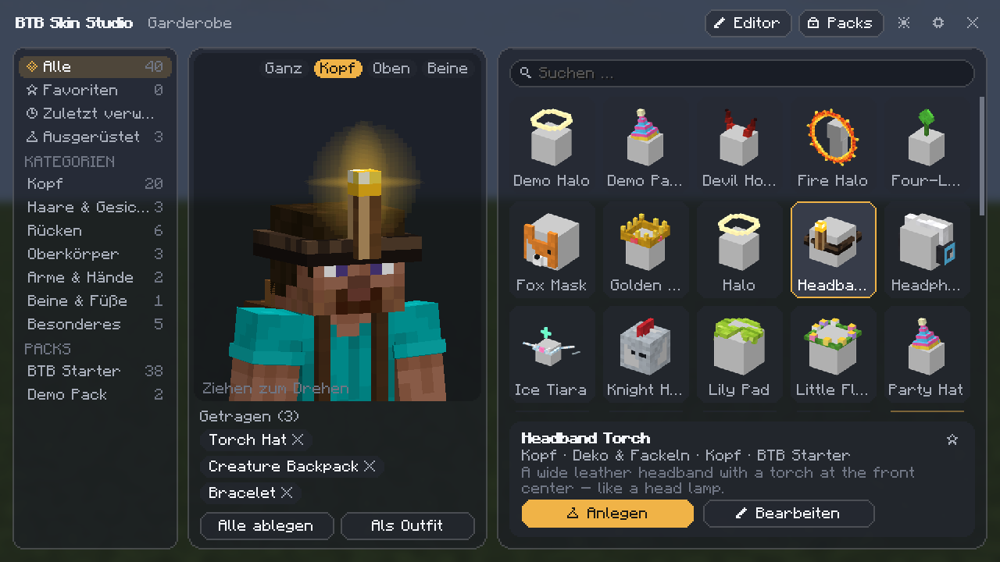
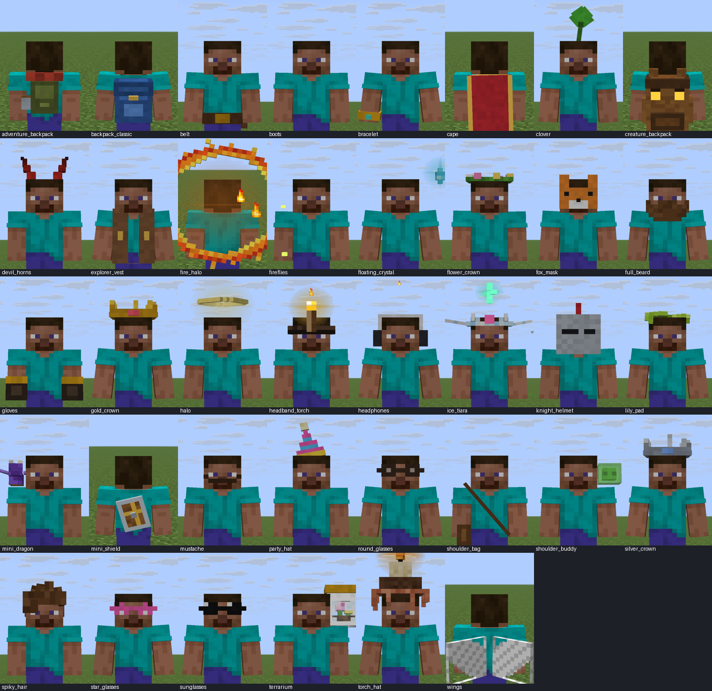
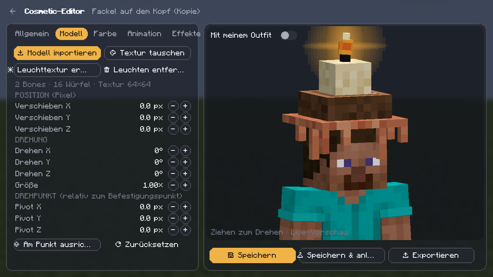

# BTB Skin Studio – Cosmetics für Minecraft Java

**Cosmetics, Garderobe und Cosmetic-Editor für Minecraft 26.3 (Fabric)** – Teil der BTB-Studios-Mod-Familie (*Behind The Blocks*). Hüte, Kronen, Brillen, Rucksäcke, Flügel, Begleiter und Effekte, die man frei kombinieren, einfärben, selbst bauen, als Pack teilen und aus Bedrock-Ressourcen übernehmen kann. Im Multiplayer sehen alle Spieler mit der Mod die Cosmetics der anderen.

*English: A Fabric mod for Minecraft 26.3 that adds wearable cosmetics, a wardrobe with live 3D preview, a cosmetic editor, an own pack format (.btbcosmeticpack / .btbcosmetic), an importer for unencrypted Bedrock resources (Persona pieces, skin-pack accessories, Blockbench models) and multiplayer sync. The in-game UI and docs are in German.*



| | |
|---|---|
| Minecraft | 26.3 (Java Edition) |
| Fabric Loader | ≥ 0.20.1 |
| Fabric API | ≥ 0.166.2+26.3 |
| Java | 25 |
| Mod-ID | `btb_skinstudio` |
| Lizenz | MIT |

## Was die Mod kann

**Garderobe (Taste J, oder Button „Garderobe“ im Pausen- und Hauptmenü)**
- Kategorien Kopf, Haare & Gesicht, Rücken, Oberkörper, Arme & Hände, Beine & Füße, Besonderes – mit 44 Untertypen
- Suche (Name, Typ, Schlagworte), Favoriten (Stern oder Rechtsklick), zuletzt verwendet, Ausgerüstet, Filter nach Pack
- Große 3D-Vorschau zum Drehen mit Ansichten Ganz/Kopf/Oben/Beine; ein ausgewähltes Cosmetic wird sofort anprobiert
- Mehrere Cosmetics gleichzeitig tragen. Konflikte werden automatisch gelöst: Ein Helm ersetzt den Hut, die Brille bleibt
- Farben aus der Palette oder frei wählbar, Outfits speichern und mit einem Klick anlegen, helles und dunkles Design

**38 eigene Starter-Cosmetics** – alle selbst modelliert, mit Texturen, Animationen und Effekten:
Fackel auf dem Kopf (Flammenanimation, Lichtschein, Funken), Stirnband mit Fackel, Seerosenblatt, Glas-Terrarium, goldene und silberne Krone, Eis-Tiara, Heiligenschein, Feuer-Halo, Teufelshörner, Blumenkrone, Kleeblatt, drei Brillen, Kopfhörer, Partyhut, Ritterhelm, Fuchsmaske, Stachelfrisur, Vollbart, Schnurrbart, drei Rucksäcke, Flügel, Umhang, Mini-Schild, Schultertasche, Abenteurer-Weste, Gürtel, Armband, Handschuhe, Stiefel, Schleimi und Mini-Drache als Schulterbegleiter, schwebender Kristall, Glühwürmchen.



**Cosmetic-Editor**
- 3D-Modell (Blockbench „Bedrock Model“ / Bedrock-Geometrie) und Textur importieren, Textur und Leuchttextur austauschen
- Befestigung an Kopf, Körper, Rücken, linkem/rechtem Arm, linkem/rechtem Bein, linker/rechter Schulter
- Verschieben, Drehen, Skalieren, Drehpunkt setzen, „Am Punkt ausrichten“ – alles live auf dem eigenen Spieler
- Animationsvorlagen (Schweben, Drehen, Wiegen, Flattern, Pulsieren, Flackern, Wedeln) oder Bedrock-Animationen importieren
- Einfärben (ganz oder per Färbemaske), Farbpalette für Spieler, Lichtschein und Partikel
- Speichern in „Meine Cosmetics“ und Export als `.btbcosmetic`



**Packs**
- Eigenes Format `.btbcosmeticpack` (ganzes Pack) und `.btbcosmetic` (einzelnes Cosmetic), dokumentiert in [docs/FORMAT.md](docs/FORMAT.md)
- Importieren per Datei-Dialog, Drag & Drop ins Spielfenster oder Import-Ordner – immer mit Vorschau und Prüfung vor dem Import
- Installieren, Aktualisieren (Versionsvergleich), Deinstallieren, Exportieren; doppelte IDs und beschädigte Dateien werden erkannt und erklärt

**Bedrock-Import** ([docs/BEDROCK.md](docs/BEDROCK.md))
- Character-Creator-Teile (Persona: `*.meta.json`, Geometrie, PNG/TGA, Tint-Maps → einfärbbar)
- Accessoires aus Skin-Packs (`skins.json` + `geometry.json`): Zusatzteile wie Hörner, Kapuzen oder Taschen werden zu tragbaren Cosmetics
- Blockbench-Modelle mit Textur und Animation, ZIP/.mcpack/Ordner
- Verschlüsselte Marketplace-Inhalte werden erkannt und **nicht** importiert – kein Kopierschutz wird umgangen

**Multiplayer**
- Ausgerüstete Cosmetics werden synchronisiert (nur IDs, Farben und Hashes, wenige hundert Byte)
- Eigene Cosmetics, die andere nicht haben, werden einmalig übertragen und beim Empfänger nach Inhalt zwischengespeichert
- Protokoll-Versionsprüfung, Server prüft alle Eingaben, unbekannte Cosmetics werden übersprungen statt abzustürzen
- Fremde Cosmetics lassen sich in den Einstellungen ausblenden


## Installation

1. Minecraft 26.3 mit **Fabric Loader 0.20.1+** installieren (https://fabricmc.net/use/).
2. **Fabric API** für 26.3 und `btb_skinstudio-<version>.jar` in den `mods`-Ordner legen.
3. Für Multiplayer gehört die Mod **auf den Server und die Clients**. Ohne Mod auf dem Server sieht jeder nur seine eigenen Cosmetics.

## Bedienung in Kurzform

| | |
|---|---|
| `J` | Garderobe öffnen (in den Steuerungs-Einstellungen änderbar) |
| Klick auf eine Karte | anprobieren; zweiter Klick oder `Enter` legt an/ab |
| Rechtsklick auf eine Karte | Favorit |
| Ziehen in der Vorschau | Spieler drehen |
| `Strg+F` | Suche |
| Dateien ins Fenster ziehen | Import-Vorschau öffnen (Garderobe, Packs, Editor) |

Befehle (clientseitig): `/skinstudio`, `/skinstudio editor [id]`, `/skinstudio packs`, `/skinstudio equip <id> [#farbe]`, `/skinstudio unequip <id>`, `/skinstudio clear`, `/skinstudio list`, `/skinstudio reload`.

Ordner im Spielverzeichnis: `btb_skinstudio/packs` (installierte Packs), `custom` (eigene Cosmetics, mit Blockbench bearbeitbar), `import` (Ablage für den Import), `exports`, `cache` (von Mitspielern empfangen). Einstellungen und Garderobe: `config/btb_skinstudio/`.

## Dokumentation

- [docs/FORMAT.md](docs/FORMAT.md) – Dateiformat `.btbcosmetic` / `.btbcosmeticpack`, Ordnerstruktur, alle Felder
- [docs/BEDROCK.md](docs/BEDROCK.md) – was aus Bedrock übernommen werden kann und was nicht
- [docs/ARCHITECTURE.md](docs/ARCHITECTURE.md) – Aufbau, Rendering, Multiplayer-Protokoll, Performance
- [docs/STATUS.md](docs/STATUS.md) – Teststand: was im Spiel geprüft ist, offene Punkte, bekannte Einschränkungen
- [docs/THIRD_PARTY.md](docs/THIRD_PARTY.md) – Lizenzen und Quellen

## Selbst bauen

```bash
git clone https://github.com/nik0bellic/BTB-Skin-Studio.git
cd BTB-Skin-Studio
./gradlew build          # JDK 25 nötig → build/libs/btb_skinstudio-<version>.jar
./gradlew runClient      # Entwicklungs-Client
python3 tools/generate_starter_pack.py   # Starter-Pack neu erzeugen (Pillow nötig)
```

Projektaufbau:
- `src/main` – gemeinsamer Code ohne Client-Abhängigkeit: Datenmodell, Formate, Pack-System, Bedrock-Importer, Sync-Server
- `src/client` – Rendering, Garderobe, Editor, Import-Oberfläche, Client-Sync
- `tools/` – Python-Generator für Modelle, Texturen, Animationen und Vorschaubilder des Starter-Packs
- `docs/` – Anleitungen und Screenshots

## Lizenz

- **Code und eigene Assets:** [MIT](LICENSE). Alle Starter-Cosmetics sind selbst erzeugt (`tools/`).
- Das Texturlayout für Persona-Kleidung folgt dem Open-Source-Projekt [Bedrock Skins](https://github.com/BrandonItaly/Bedrock-Skins) (MIT) – siehe [docs/THIRD_PARTY.md](docs/THIRD_PARTY.md).

Kein offizielles Minecraft-Produkt. Nicht von Mojang oder Microsoft genehmigt oder mit ihnen verbunden.
